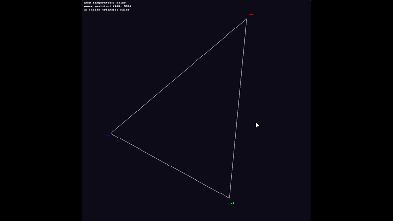
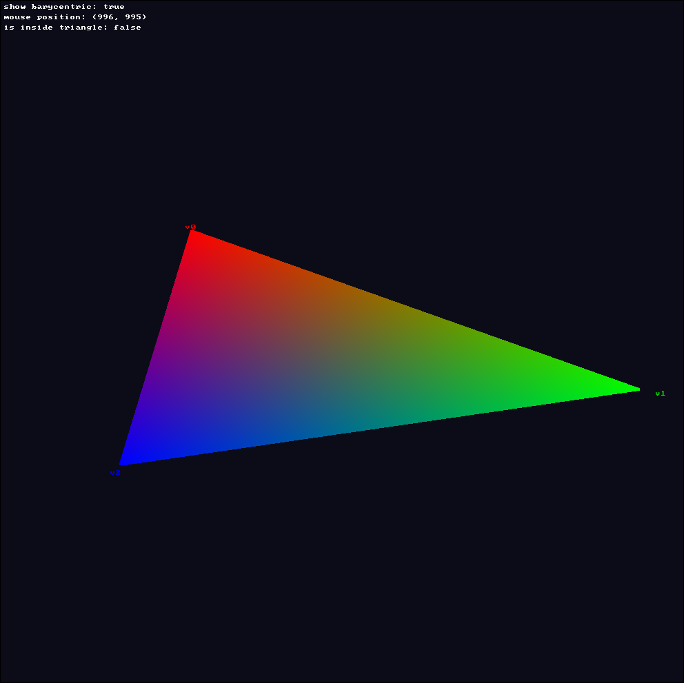

# Barycentric Zoordinates

A small interactive visualizer for **2D Barycentric Coordinates** and triangle color interpolation built with **Zig** and **SDL3**.

<p align="center">
  
  
</p>

## Features

- Random 2D triangle generation with RGB vertex colors (`v0`, `v1`, `v2`)
- Point-in-triangle testing using the 2D edge cross-product function
- Real-time barycentric weights (`w1`, `w2`, `w3`) and interpolated RGB readout at the mouse cursor
- Sub-triangle edge visualization connecting the cursor to each vertex when inside the triangle
- Toggleable barycentric color interpolation fill (baked once into an `SDL_Texture`)

## Controls

| Input | Action |
| :--- | :--- |
| **Mouse Move** | Inspect barycentric weights, interpolated RGB values, and sub-triangle lines |
| **`E`** | Toggle barycentric color fill on/off |

## Project Structure

- `src/main.zig` — Window setup, triangle initialization, and main event loop
- `src/renderer.zig` — SDL3 rendering, texture baking, and on-screen debug HUD
- `src/triangle.zig` — `Triangle` and `Vertex` definitions, bounding box, centroid, and point-in-triangle check
- `src/barycentric.zig` — Edge cross-product function, barycentric weight calculation, and RGB color interpolation
- `src/helper.zig` — Vector/color types and random number helpers

## Build & Run

Requires **Zig 0.17.0**:

```bash
zig build run
```
